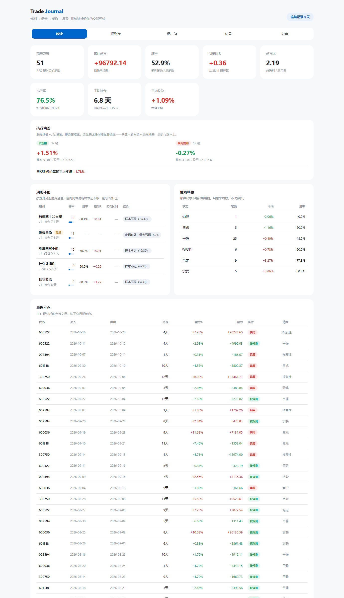

# Trade Journal · 个人交易经验终端

把「凭感觉炒股」变成「用可判定的规则交易，并用自己的操作记录做统计检验」。

这不是一个选股工具，也不预测涨跌。它只回答一个问题：**我这套方法，在我自己的操作里，到底成不成立？**



## 它解决什么问题

多数人做了一段时间交易，能说出一堆经验：「放量突破要追」「跌破均线就该走」「别追高」。

问题是这些经验**无法被检验**。赚了感觉是自己厉害，亏了归咎于大盘不好，几年下来还是不知道自己哪条经验有效、哪条纯粹是错觉。

本项目把经验变成一条流水线：

```
规则（假设） → 信号（触发证据） → 操作（真实成交） → 复盘（归因）
                                        ↓
                                  统计检验（期望值 / 置信区间 / 执行偏差）
```

关键设计：**规则必须机器可判定**。写不成条件表达式的经验，说明它还不够明确——这本身就是一次有效的心智整理。

## 四个核心判断

### 1. 信号 ≠ 成交

规则触发是一个事实，你下不下单是另一个事实。两者分开记录，才能算出「规则准不准」和「我执不执行」两件完全不同的事。

### 2. 「是否按规则」是归因的基石

每笔交易必须回答：这次是按规则做的，还是我自己加了想法？
- 按规则赚钱 → 规则有效
- 按规则亏钱 → 规则需要改
- 偏离规则赚钱 → 危险信号，会强化坏习惯
- 偏离规则亏钱 → 执行问题，不是规则问题

没有这个字段，所有统计都会退化成自我安慰。

### 3. 样本量是不可绕过的硬约束

入场规则至少 30 次才有统计意义。在攒够之前，系统会明确写「样本不足（19/30）」，而不是给你一个漂亮的胜率让你误判。

用 Bootstrap 置信区间代替 p 值——样本少的时候区间会很宽，这比一个虚假的「显著」诚实得多。

### 4. 离场规则不能用胜率评判

止损规则天然接近 0% 胜率，因为它就是用来认亏的。用入场标准去评价它，会得出「这条规则很烂」的荒谬结论。
系统对 `exit` / `risk` 类规则改用「最大亏损是否被截断」作为判定口径。

### 5. R 倍数必须有真实止损作分母

同样是赚 10%：止损 2% 是 5R，止损 20% 只有 0.5R。**止损设得越宽，同样的盈利越不值钱**，这也是止损不能随便放宽的数学原因。

所以每笔买入都可以填真实止损价，规则上也能配默认止损幅度。两者都没有时退回 3% 兜底——但界面会把这类样本单独标出来，告诉你「这些 R 不可全信」，而不是藏起来给你一个漂亮的期望值。

「最近平仓」表里有独立的 R 列，每笔都标注了分母来源：`实`（真实止损价）/ `规`（规则默认）/ `估`（3% 兜底）。首页还有一条口径进度条，显示这三个来源各占多少。

## 快速开始

需要 Python 3.10+。

```bash
python -m venv .venv
.venv\Scripts\activate          # Windows
# source .venv/bin/activate     # macOS / Linux

pip install -e ".[dev]"
python -m trade_journal
```

浏览器会自动打开 `http://127.0.0.1:8765`。

Windows 下也可以直接双击 `start.bat`，首次运行会自动建环境、装依赖。

想先看看统计长什么样，可以灌入演示数据（**模拟数字，不代表任何业绩**）：

```bash
python -m trade_journal.seed
```

演示数据用完必须清掉，否则会和真实记录混在一起，统计就失去意义：

```bash
python -m trade_journal.reset --yes     # 自动备份后清空
```

## 怎么用：从零到第一份可信统计

这个工具的价值不在「记录」，而在攒够样本后能回答「我这套方法成不成立」。所以使用节奏比功能更重要。

### 第 0 步：先把规则写下来（约 30 分钟）

打开「规则库」页签，把你**最有把握**的那几条经验写成条件。只写 2~3 条，不要贪多。

判断标准很简单：**如果这条规则触发时你还需要犹豫，说明它写得不明确**。

举个例子，你脑子里可能是「放量突破要买」，这没法执行。拆成可判定的：

```
close > ma20 and vol_ratio > 1.5 and macd_hist > 0
```

再给每条规则配一个默认止损幅度（比如 4%），这是 R 倍数的分母。

### 第 1 步：每天盘后花 5 分钟记录

只记两件事，都在「记一笔」页签：

**触发规则但没买** → 这属于信号，不是交易。目前第一版信号录入在 API 层（`POST /api/signals`），界面上的按钮在「信号」页签扫出结果后点「记成信号」。老实记下来，尤其是**放弃的理由**。

**真的成交了** → 记一笔，六个字段必须填准：

| 字段 | 为什么关键 |
| --- | --- |
| 价格 / 数量 / 日期 | 基础，算盈亏用 |
| **止损价** | 填了 R 才准。不填就退回规则默认，再没有只能估 |
| **关联规则** | 决定这笔算到哪条规则头上，选「计划外操作」也很有价值 |
| **是否按规则执行** | 整个系统的支点，别随手勾 |
| **偏离原因** | 勾了「否」就必须写。用第一人称写实话，别写「提前止盈了」，写「怕利润回吐，手抖卖了」 |
| **情绪** | 一行就够，长期能挖出你的亏钱模式 |

卖出单不用填止损价，系统会自动禁用。

### 第 2 步：别急着看胜率（第 1~4 周）

这段时间统计页上会写「样本不足（12/30）」。**这是系统在保护你，不是没做完。**

按你一天不到 10 笔、中短线的节奏，单条规则攒够 30 个样本通常要三到五周。这期间唯一该看的是「执行偏差」那张表——它样本要求低（十几笔就有参考价值），而且反映的是你最该改的东西。

### 第 3 步：开始看统计（第 5 周之后）

按这个顺序看，顺序很重要：

1. **执行偏差** —— 照规则做和没照做，差多少。如果偏离那边明显更差，你的问题不在规则，在纪律。
2. **规则体检** —— 每条规则的期望 R 和 95% 置信区间。区间跨零就是还没结论，别急着重仓。
3. **R 倍数的口径** —— 兜底样本占多少。超过一半就先补止损价的记录习惯，再看期望值。
4. **情绪画像** —— 哪种状态下最赔钱。这张表通常最扎心也最有用。

### 第 4 步：只在有证据时改规则

看到「期望为负」才该改，而且**改条件会自动升版本号**——老样本归旧版本，新样本归新版本，各自统计。这样才能分清「是规则改了变好」还是「行情配合」。

如果只是调整止损幅度，不算改条件，不升版。但要注意：止损一改，同样的收益折算出的 R 就变了，老样本的 R 不可直接比较。

### 一个容易忽略的习惯

每周日花十分钟，把这一周偏离规则的交易看一遍，问自己：**如果当时按规则做，现在会怎样？**

不用算得很精确，凭印象就行。这个动作比看任何统计图都更能改变行为——因为你会开始记得「上次没照做，结果更差」。

## 规则怎么写

规则是一套极小的表达式子集，自己解析，不用 `eval`。

```text
close > ma20 and vol_ratio > 1.5 and macd_hist > 0     # 放量站上20日线
close > ma60 and pct_chg > -2 and vol_ratio < 0.8      # 缩量回踩不破
close > ma20 and close@prev <= ma20@prev               # 上穿20日线（金叉）
close < ma10 and pnl_pct < -5                          # 破位离场
```

- 比较符：`>` `>=` `<` `<=` `=` `!=`
- 逻辑：`and` `or`，支持括号
- 操作数：数字，或另一个字段（`close > ma20`）
- 前一根 K 线：`字段@prev` 或 `字段_prev`

可用字段见界面上的字段列表，或 `GET /api/rules/fields`。

**刻意不支持的**：四则运算、跨股票比较、时间函数。写不出来说明规则还不够明确——这是特性，不是缺陷。

## 每天的实际节奏

上面讲的是战略，这里是一天的具体动作：

1. **盘前（1 分钟）**：翻一下规则库，确认今天盯哪几条，别凭感觉临时加条件
2. **盘中**：触发规则就记信号（用「批量扫描」粘贴行情快照最快），没触发就什么也不做
3. **下单后（2 分钟）**：记一笔操作，老实勾选「是否按规则」，写下止损价和情绪
4. **盘后（2 分钟）**：对平掉的仓位写复盘，只写事实，禁止写「要不是大盘……」
5. **每周日（10 分钟）**：看执行偏差表，把偏离规则的交易回顾一遍

如果某天什么都没做，不用强行记录——空仓也是一种决策，但不必为了打卡而编造记录。

## 项目结构

```
trade_journal/
  rule_engine.py   规则 DSL：词法、语法、求值（零依赖，可单独复用）
  stats.py         FIFO 配对、期望值、Bootstrap 区间、执行偏差、情绪画像
  repository.py    所有 SQL 集中在此，路由层不写裸 SQL
  db.py            SQLite schema（四张表：rules/signals/trades/reviews）
  app.py           FastAPI 路由
  seed.py          演示数据生成
static/index.html  单页前端，无构建链
tests/             65 个测试
docs/              设计说明
```

## 技术栈与取舍

| 选择 | 理由 |
| --- | --- |
| SQLite | 个人工具，单文件、零运维、可随时备份 |
| FastAPI | 需要 JSON API，顺便产出可交互的 OpenAPI 文档 |
| 自研规则 DSL | `eval` 是注入漏洞；自然语言不可判定。两者都违背「可验证」前提 |
| 单页无构建 | 不需要 Node、不需要打包，双击就能跑 |
| Bootstrap 而非 t 检验 | 样本普遍 < 100，p 值没有意义，会给虚假的确定感 |

## 已知局限

- **没有行情接口**，行情快照需要手工或外部脚本提供（数据源接入是下一版的事）
- **FIFO 配对不区分加仓意图**，同一只票多次建仓会被视为连续仓位
- **不做显著性检验**，这是有意的保守选择
- **R 倍数依赖止损价的填写质量**，没填的会退回规则默认或 3% 兜底，口径透明度面板会如实显示比例

## 测试

```bash
pytest
```

83 个测试覆盖：规则解析边界与注入尝试、FIFO 配对（含部分卖出、跨批次、多股票隔离）、统计聚合、离场规则口径、R 倍数三种分母来源及其边界（止损填反、过窄、越界）、旧库迁移、API 全链路。

## License

MIT
